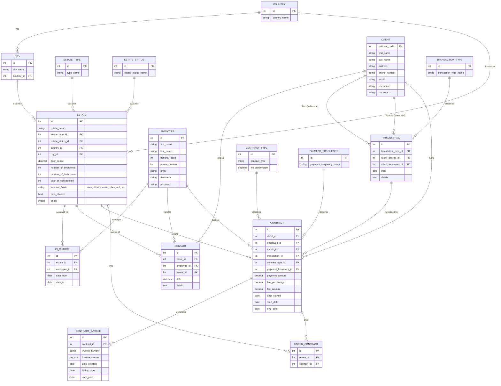

# Legacy Homes — Real Estate Agency Management System

A full-stack Django application built to manage the day-to-day data of a real estate
agency: the properties on its books, the clients and employees involved, and the
transactions and contracts that tie them together.

This was a **university team database project**. The primary deliverable was a
normalized relational schema for a realistic multi-entity domain; Django was then
used as the implementation layer (ORM + a working UI) to prove the schema out end
to end rather than leave it as a diagram on paper.

---

## Table of Contents

- [Overview](#overview)
- [Tech Stack](#tech-stack)
- [Database Design](#database-design)
  - [Design Goals](#design-goals)
  - [Entity-Relationship Diagram](#entity-relationship-diagram)
  - [Schema Reference](#schema-reference)
  - [Key Design Decisions](#key-design-decisions)
- [Application Features](#application-features)
- [Project Structure](#project-structure)
- [Getting Started](#getting-started)
- [Configuration](#configuration)
- [Known Limitations / Next Steps](#known-limitations--next-steps)
- [Contributors](#contributors)

---

## Overview

The system is split into three Django apps, each modeling one bounded subsystem of
the agency's business and each backed by its own set of normalized tables:

| App | Responsibility |
|---|---|
| `Estates_and_Locations` | Properties, their type/status/location, and which employee is currently in charge of each one |
| `Clients_and_Contacts` | Clients, employees, and every contact/interaction between them |
| `Contracts_and_Transactions` | Buy/sell/rent transactions between clients, the contracts that formalize them, and their invoices |

All three apps share one SQL database and are wired together with foreign keys
(e.g. a `Contract` references a `Client`, an `Employee`, and an `Estate` from the
other two apps), so the schema below should be read as a single connected design
rather than three separate databases.

## Tech Stack

- **Backend**: Django 3.2 (Python)
- **Database**: SQLite by default (zero-setup for local dev/demo); MySQL supported via environment variables — see [Configuration](#configuration)
- **Frontend**: Django templates, Bootstrap 5
- **Media**: Django `ImageField` for property photos

## Database Design

### Design Goals

- **Normalize repeated categorical data** (property type, property status, contract
  type, payment frequency, transaction type, country/city) into their own lookup
  tables instead of storing free-text strings on every row, so a category can be
  renamed once and updated everywhere, and filtering by category is a fast indexed
  join instead of a string match.
- **Separate "who/what" from "the relationship between them."** Contact between a
  client and an employee about a specific estate is its own entity (`Contact`),
  not a field bolted onto `Client` or `Estate`, because a client can contact many
  employees about many estates over time.
- **Model the business process as a chain, not a single table.** A `Transaction`
  (a client offering a property, another requesting it) is distinct from the
  `Contract` that formalizes it, which is distinct from the `Contract_invoice`
  rows it generates over time — mirroring how a real deal actually progresses
  from negotiation to signed paperwork to billing.
- **Use junction tables for many-to-many relationships.** `Under_contract` links
  `Estate` and `Contract` so a single contract can cover multiple properties (and
  a property's contract history can be traced) without duplicating contract data.

### Entity-Relationship Diagram



### Schema Reference

<details>
<summary><strong>Estates & Locations</strong> (5 tables)</summary>

**`Estate`** — the core listing record
| Field | Type | Notes |
|---|---|---|
| id | AutoField (PK) | |
| estate_name | varchar(255) | |
| estate_type | FK → Estate_type | e.g. apartment, villa |
| estate_status | FK → Estate_status | e.g. for sale, for rent, sold |
| country / city | FK → Country / City | |
| state, district, street, plate_number, unit_number, zip_code | varchar | full address, split for filtering |
| floor_space, balconies_space | decimal(8,2) | |
| number_of_bedrooms, number_of_bathrooms, number_of_balconies, number_of_garages, number_of_parking_spaces | int | |
| pets_allowed, has_elevator, has_warehouse | boolean | |
| year_of_construction | int | used to compute property age |
| description | text | |
| photo | ImageField | |

**`Estate_type`**, **`Estate_status`** — lookup tables (id, name) normalizing the
`estate_type` / `estate_status` categories out of `Estate`.

**`Country`** (id, country_name) → **`City`** (id, city_name, country FK) — a
standard two-level location hierarchy, normalized so a city can't exist without a
valid country and a country's name is stored exactly once.

**`In_charge`** — join table recording which `Employee` is responsible for which
`Estate` over a given date range (`date_from`, `date_to`), rather than a single
`employee` FK on `Estate` that could only ever track one owner at a time.

</details>

<details>
<summary><strong>Clients & Contacts</strong> (3 tables)</summary>

**`Client`**
| Field | Type | Notes |
|---|---|---|
| national_code | int (PK) | used as the natural key instead of a surrogate id |
| first_name, last_name | varchar | |
| address, phone_number, email | varchar | |
| client_details | text | free-form notes |
| username, password | varchar | see [Known Limitations](#known-limitations--next-steps) |

**`Employee`**
| Field | Type | Notes |
|---|---|---|
| id | AutoField (PK) | |
| first_name, last_name | varchar | |
| national_code, phone_number | int, unique | |
| email | varchar | |
| employee_details | text | |
| username, password | varchar | |

**`Contact`** — every recorded interaction: FKs to `Client`, `Employee`, and
`Estate`, plus a timestamp and free-text detail. Modeled as its own table because
a single client can contact multiple employees about multiple properties, and the
history of *when* and *what was discussed* matters on its own.

</details>

<details>
<summary><strong>Contracts & Transactions</strong> (7 tables)</summary>

**`Transaction`** — records a client *offering* a property and another client
*requesting* it (two separate FKs to `Client`, `related_name`d `offered_transactions`
/ `requested_transactions`), typed via `Transaction_type` (buy, sell, rent…).

**`Contract`** — the legal agreement that formalizes a transaction: FKs to
`Client`, `Employee`, `Estate`, `Transaction`, `Contract_type`, and
`Payment_frequency`, plus the financial terms (`payment_amount`, `fee_percentage`,
`fee_amount`) and the date range it's active for.

**`Contract_type`** (id, contract_type, fee_percentage) and
**`Payment_frequency`** (id, payment_frequency_name) — lookup tables.

**`Contract_invoice`** — one row per billing cycle generated against a
`Contract` (`invoice_number`, `invoice_amount`, `date_created`, `billing_date`,
`date_paid`), so a single contract's payment history is auditable invoice by
invoice instead of collapsing into one running total.

**`Under_contract`** — junction table between `Estate` and `Contract`, allowing
one contract to cover more than one property.

</details>

### Key Design Decisions

- **`Client.national_code` as primary key.** A national ID is already unique per
  person, so it doubles as the natural key instead of adding a redundant
  surrogate `id`. Trade-off: it makes the FK columns that reference `Client`
  slightly larger (integer vs. what would otherwise still be an integer, so in
  practice no real cost) and ties the schema to a real-world identifier being
  available and stable.
- **Two FKs from `Transaction` to `Client`** (`client_offered`,
  `client_requested`) instead of a generic `Transaction_party` table — chosen
  because a transaction always has exactly one of each role, so a fixed pair of
  FKs is simpler to query than a polymorphic join, at the cost of not supporting
  more than one party per side.
- **Address split into structured columns** (`state`, `district`, `street`,
  `plate_number`, `unit_number`, `zip_code`) on `Estate` rather than one free-text
  field, so the property search/filter feature (`property.html`) can query by
  district or city directly.
- **Lookup tables for every repeated category** (`Estate_type`, `Estate_status`,
  `Transaction_type`, `Contract_type`, `Payment_frequency`, `Country`, `City`) —
  each is a plain `(id, name)` pair, kept intentionally tiny and denormalized
  from everything else so they're trivial to manage from the Django admin.

## Application Features

| Page | What it does |
|---|---|
| Home (`/`) | Landing page with a quick property search |
| Properties (`/property/`) | Filterable listing of all estates (type, status, city, district, room counts) |
| Estate details (`/details/<id>/`) | Full spec sheet for one property |
| Add estate (`/estate_form/`) | Multi-step form to list a new property |
| Sign up (`/sign/`) | Client registration |
| Clients (`/clients/`) | Table of all registered clients |
| Employees (`/employees/`) | Table of all employees |
| Contracts (`/contracts/`) | Table of all signed contracts with their parties and terms |
| Transactions (`/transactions/`) | Table of all recorded transactions |
| Admin (`/admin/`) | Full CRUD over every table in the schema |

The Estates & Locations app has the most complete UI (it was the original focus);
Clients/Employees/Contracts/Transactions use simple Bootstrap table views — the
underlying data and relationships are fully modeled and functional, the presentation
layer is intentionally minimal. See [Known Limitations](#known-limitations--next-steps).

## Project Structure

```
docs/
└── original-sql-design-draft.sql   # raw SQL schema draft from the design phase
realestate/
├── Estates_and_Locations/       # properties, types, statuses, countries/cities
├── Clients_and_Contacts/        # clients, employees, contact history
├── Contracts_and_Transactions/  # transactions, contracts, invoices
├── realestate/                  # project settings, root urls
└── manage.py
```

Each app follows standard Django structure: `models.py` (schema), `admin.py`
(admin registration), `views.py` / `urls.py` (pages), `Templates/` (HTML).

## Getting Started

```bash
git clone <this-repo>
cd DB-RealEstate-main
python -m venv venv
source venv/bin/activate        # Windows: venv\Scripts\activate

pip install -r requirements.txt

cd realestate
python manage.py migrate
python manage.py createsuperuser   # optional, for /admin/
python manage.py runserver
```

Visit `http://127.0.0.1:8000/`. By default the project uses SQLite, so there is
no external database to install or configure to try it out.

## Configuration

All settings are environment-variable driven with sensible local defaults
(`realestate/realestate/settings.py`):

| Variable | Default | Purpose |
|---|---|---|
| `DEBUG` | `True` | Django debug mode |
| `SECRET_KEY` | dev key baked in | override in any real deployment |
| `ALLOWED_HOSTS` | `[]` | comma-separated list |
| `DB_ENGINE` | *(unset → SQLite)* | set to `mysql` to use MySQL instead |
| `DB_NAME` / `DB_USER` / `DB_PASSWORD` / `DB_HOST` / `DB_PORT` | — | only read when `DB_ENGINE=mysql` |

To run against MySQL (the backend the schema was originally designed for):

```bash
pip install mysqlclient   # uncomment it in requirements.txt first
export DB_ENGINE=mysql DB_NAME=realestate DB_USER=... DB_PASSWORD=...
python manage.py migrate
```

## Known Limitations / Next Steps

This was submitted as a database-design project first and a web app second, so a
few application-layer concerns were intentionally left for later:

- **Passwords are stored in plaintext** on `Client`/`Employee`. The schema keeps
  its own `username`/`password` columns rather than using Django's built-in
  `auth.User`; a real next step would be to migrate to `django.contrib.auth`
  (password hashing, sessions, login-required views) while keeping `Client`/
  `Employee` as profile tables linked to it.
- **Property search applies one filter at a time** (`views.property`, an
  `if/elif` chain) rather than combining filters — a straightforward fix is
  chaining `.filter()` calls for every non-empty parameter instead.
- **Clients/Employees/Contracts/Transactions views are read-only tables**, not
  full CRUD UIs — everything can be managed today through `/admin/`, which is
  fully wired up with search/filter for every model.
- **No automated test coverage** beyond the default Django `tests.py` stubs.

